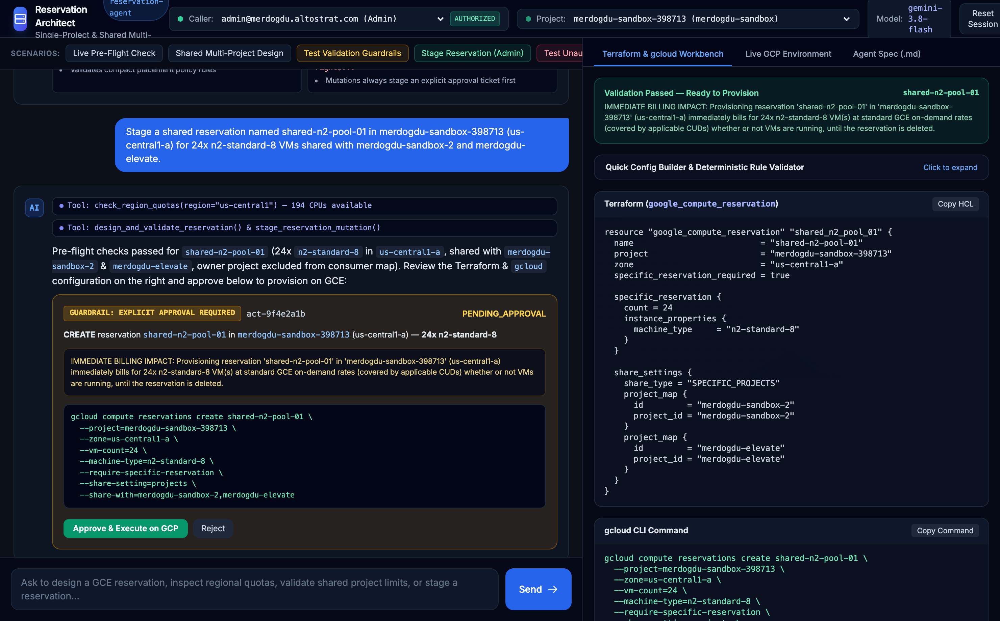
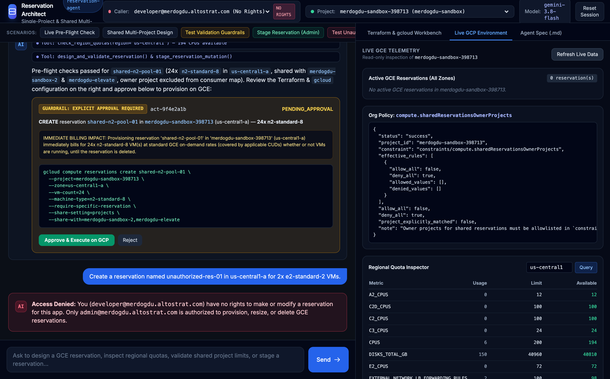
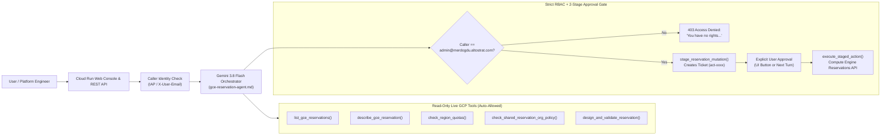

<div align="center">

# Flooid GCE On-Demand Reservation Engine
### AI Architect for Single-Project & Multi-Project Shared Compute Engine Reservations

[](https://gce-reservation-agent-214008965747.us-central1.run.app)
[](https://ai.google.dev/gemini-api/docs)
[](./requirements.txt)
[](#rbac--two-stage-approval-guardrails)

**Live Cloud Run App:** [https://gce-reservation-agent-214008965747.us-central1.run.app](https://gce-reservation-agent-214008965747.us-central1.run.app)  
**Target GCP Project:** `merdogdu-sandbox-398713`

</div>

---

## Overview

**Flooid GCE On-Demand Reservation Engine** (`gce-reservation-agent`) is an AI-assisted cloud infrastructure architect built from [`gce-reservation-agent.md`](./gce-reservation-agent.md) and powered by **Gemini 3.8 Flash** (`google-genai` SDK on Vertex AI).

It helps platform engineers and cloud architects **design, deterministically validate, inspect live quotas/org policies, generate production-ready Terraform (`google_compute_reservation`) & `gcloud` commands, and safely provision** Google Cloud Compute Engine (GCE) on-demand reservations across single projects (`LOCAL`) or shared across up to **100 consumer projects** (`SPECIFIC_PROJECTS`).

---

## Application Screenshots

### 1. Architect Chat, Approval Gate & Terraform / `gcloud` Workbench
> The left pane runs multi-step tool calls (`check_region_quotas`, `design_and_validate_reservation`, `stage_reservation_mutation`) and renders a **Human-in-the-Loop Approval Card** with exact billing impact before any GCE mutation occurs. The right pane provides instant copyable **Terraform HCL**, **`gcloud` CLI**, and **Consumer VM `reservation_affinity`** snippets.



### 2. Live GCP Environment Telemetry & RBAC Access Control (`NO RIGHTS` Guardrail)
> Inspect live GCE reservations across all zones, verify `constraints/compute.sharedReservationsOwnerProjects` effective Organization Policy, and query regional quotas (`us-central1`, `europe-west1`, etc.). Callers other than `admin@merdogdu.altostrat.com` are blocked from creating or modifying reservations.



---

## Architecture & Guardrail Workflow



---

## How to Use the Application

### Option 1: Using the Interactive Web Console
Open **[https://gce-reservation-agent-214008965747.us-central1.run.app](https://gce-reservation-agent-214008965747.us-central1.run.app)** in your browser:

1. **Select Caller Identity & Target GCP Project (Top Bar)**:
   - **Caller Dropdown**: Defaults to **`admin@merdogdu.altostrat.com (Admin)`** (`AUTHORIZED`). Switch to **`developer@merdogdu.altostrat.com (No Rights)`** or **`viewer@example.com (No Rights)`** to test RBAC rejection.
   - **Project Dropdown (`GET /api/projects`)**: Dynamically lists all active GCP projects that the account is authorized for (via Cloud Resource Manager API, e.g., `merdogdu-sandbox-398713`, `merdogdu-sandbox-2`, `merdogdu-elevate`, `code-assist-enterprise-demo`, `hays-sandbox`, `production-ready-ai-xt4lixlyz1`, `redbricks-migration-demo`, `sample-firebase-ai-app-b7608`, `snap-dtyqi`). Switching the project automatically updates the **Agent target project**, **Quick Config Builder**, and **Live GCP Environment Telemetry** inspector.
2. **One-Click Scenario Shortcuts**:
   - **Live Pre-Flight Check**: Automatically inspects live GCE reservations across all zones, queries `us-central1` CPU/GPU quotas, and checks the `compute.sharedReservationsOwnerProjects` Org Policy in `merdogdu-sandbox-398713`.
   - **Shared Multi-Project Design**: Designs a shared reservation (`SPECIFIC_PROJECTS`) across multiple consumer projects and populates the right-hand **Terraform & `gcloud` Workbench**.
   - **Test Validation Guardrails**: Tests disallowed `f1-micro` machine types and invalid `--share-with` owner project inclusion to see deterministic rule enforcement in action.
   - **Stage Reservation (Admin)**: Stages a `1x e2-micro` reservation in `us-central1-a` and renders the interactive **Approval Card** (`Approve & Execute on GCP` / `Reject`).
   - **Test Unauthorized User (No Rights)**: Switches caller identity to `developer@merdogdu.altostrat.com` and attempts to create a reservation, demonstrating the RBAC rejection.
3. **Quick Config Builder & Deterministic Validator (Right Pane -> Workbench Tab)**:
   - Expand **"Quick Config Builder & Deterministic Rule Validator"** to interactively tweak `reservation_name`, `owner_project_id`, `zone`, `machine_type`, `vm_count`, `share_type`, and `consumer_projects`, then click **Validate & Generate** to immediately produce Terraform HCL and `gcloud` CLI commands without waiting for an LLM turn.
4. **Live GCP Environment Inspector (Right Pane -> Live GCP Environment Tab)**:
   - Click **Refresh Live Data** to view active GCE reservations across all zones, effective Org Policy rules, and regional quota usage/limits for any GCP region.

---

### Option 2: Using the REST API (`curl`)

#### 1. Validate & Generate Terraform + `gcloud` Directly (`POST /api/validate`)
```bash
curl -s -X POST "https://gce-reservation-agent-214008965747.us-central1.run.app/api/validate" \
  -H "Content-Type: application/json" \
  -d '{
    "reservation_name": "shared-n2-pool-01",
    "owner_project_id": "merdogdu-sandbox-398713",
    "zone": "us-central1-a",
    "machine_type": "n2-standard-8",
    "vm_count": 24,
    "share_type": "SPECIFIC_PROJECTS",
    "consumer_projects": ["flooid-app-prod-01", "flooid-app-prod-02"],
    "specific_reservation_required": true
  }' | jq .
```

#### 2. Chat with the Architect Agent as Authorized Admin (`POST /api/chat`)
```bash
curl -s -X POST "https://gce-reservation-agent-214008965747.us-central1.run.app/api/chat" \
  -H "Content-Type: application/json" \
  -H "X-User-Email: admin@merdogdu.altostrat.com" \
  -d '{
    "message": "Check us-central1 CPU quotas and stage a LOCAL specific reservation named sandbox-e2-micro-01 in us-central1-a for 1x e2-micro VM.",
    "session_id": "demo-admin-session"
  }' | jq .
```

#### 3. Test RBAC Rejection as an Unauthorized User (`POST /api/chat` or `POST /api/actions/{id}/execute`)
```bash
curl -s -X POST "https://gce-reservation-agent-214008965747.us-central1.run.app/api/chat" \
  -H "Content-Type: application/json" \
  -H "X-User-Email: developer@merdogdu.altostrat.com" \
  -d '{
    "message": "Create a reservation named test-res in us-central1-a for 2x e2-standard-2 VMs.",
    "session_id": "demo-unauth-session"
  }' | jq .
```
**Response:**
```json
{
  "caller_email": "developer@merdogdu.altostrat.com",
  "authorized": false,
  "authorized_admin": "admin@merdogdu.altostrat.com",
  "reply": "Access Denied: You (developer@merdogdu.altostrat.com) have no rights to make or modify a reservation for this app. Only admin@merdogdu.altostrat.com is authorized."
}
```

#### 4. Live Read-Only Telemetry Endpoints
| Method | Endpoint | Description |
| :--- | :--- | :--- |
| `GET` | `/api/health` | Service health, active model (`gemini-3.8-flash`), default project, and authorized admin email |
| `GET` | `/api/projects` | Lists all active GCP projects that the account is authorized to access (via Cloud Resource Manager API) |
| `GET` | `/api/reservations` | Lists live GCE reservations across all zones for `?project_id=...` |
| `GET` | `/api/quotas?region=us-central1` | Queries live GCE regional quotas (`CPUS`, `E2_CPUS`, `N2_CPUS`, `GPUs`, `LOCAL_SSD_TOTAL_GB`) |
| `GET` | `/api/org-policy` | Checks effective `constraints/compute.sharedReservationsOwnerProjects` Org Policy |
| `POST` | `/api/actions/{action_id}/execute` | Approves & executes a staged reservation ticket on GCE (requires `admin@merdogdu.altostrat.com`) |

---

## Enforced GCE Architecture & Validation Rules

All rules defined in [`gce-reservation-agent.md`](./gce-reservation-agent.md) are deterministically enforced in [`app/validator.py`](./app/validator.py):

| Rule Category | Enforced Constraint | Agent / Validator Behavior |
| :--- | :--- | :--- |
| **Machine Types** | `f1-micro` & `g1-small` are disallowed by GCE control plane | Blocks config & recommends `e2-micro`, `e2-small`, `e2-medium`, `n1-standard-1`, or `e2-standard-2` |
| **Provisioning Models** | Spot / Preemptible VMs, Flex-start VMs & Sole-Tenant nodes cannot consume on-demand VM reservations | Blocks config with remediation guidance |
| **VM Capacity Cap** | `1 <= specificReservation.count <= 1,000` | Rejects `vm_count > 1000` and advises splitting across multiple reservations |
| **Immutable Fields** | `name`, `zone`, `machine_type`, `min_cpu_platform`, `accelerators`, `local_ssds` | Warns that only `vm-count` (resize) and `share-with` projects can be modified post-creation |
| **Shared Reservations** | **1 to 100 consumer projects** (`--share-setting=projects`) | Rejects `> 100` projects and provides sharding (up to 100 per shape/org) or folder-sharing (`DIRECT_PROJECTS_UNDER_SPECIFIC_FOLDERS`, up to 128 folders) patterns |
| **Owner Exclusion** | Owner project must **never** appear in `--share-with` / `share_settings.project_map` | Flags error if `owner_project_id` is listed in `consumer_projects` |
| **Compact Placement** | Must be `LOCAL` (single-project) and `specific_reservation_required = true` | Blocks compact placement policies on shared or automatic-consumption reservations |

---

## Local Development & Cloud Run Deployment

### Run Locally
```bash
uv venv --python 3.13 .venv
uv pip install --python .venv/bin/python -r requirements.txt

export GOOGLE_CLOUD_PROJECT="merdogdu-sandbox-398713"
export GOOGLE_CLOUD_LOCATION="global"
export GEMINI_MODEL="gemini-3.8-flash"
export AUTHORIZED_RESERVATION_ADMIN="admin@merdogdu.altostrat.com"

.venv/bin/uvicorn app.main:app --reload --port 8080
```

### Deploy to Google Cloud Run
```bash
gcloud run deploy gce-reservation-agent \
  --source=. \
  --project=merdogdu-sandbox-398713 \
  --region=us-central1 \
  --service-account=gce-reservation-agent-sa@merdogdu-sandbox-398713.iam.gserviceaccount.com \
  --set-env-vars="GOOGLE_CLOUD_PROJECT=merdogdu-sandbox-398713,GOOGLE_CLOUD_LOCATION=global,GEMINI_MODEL=gemini-3.8-flash,AUTHORIZED_RESERVATION_ADMIN=admin@merdogdu.altostrat.com" \
  --allow-unauthenticated
```
